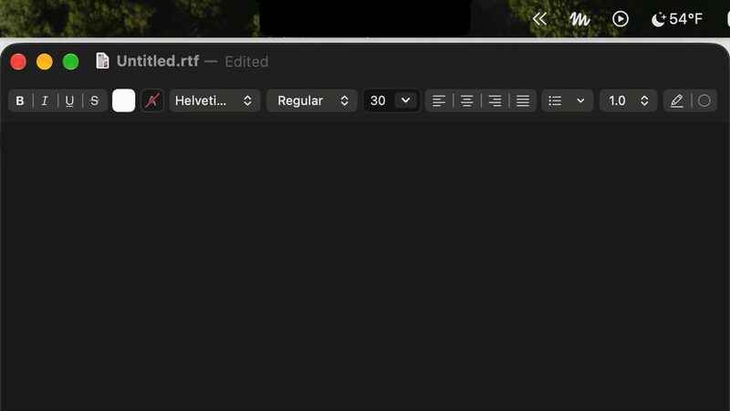
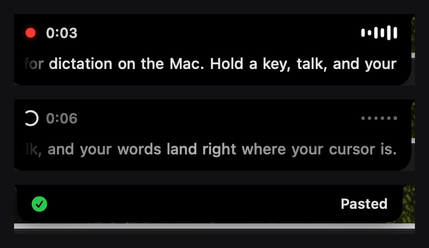

# DictationIsland

Voice dictation that lives in your MacBook's notch. Hold a key and talk: the island grows out of
the notch with a live transcript, and when you let go the text is pasted wherever your cursor is.
Everything runs on-device.



<p align="center"></p>

## Install

Requires **macOS 26** or later. Works best on a Mac with a notch; other displays get a pill in
the menu bar.

### Download

1. Download `DictationIsland-<version>.dmg` from the
   [latest release](https://github.com/BinhL3/DictationIsland/releases/latest).
2. Open it and drag **DictationIsland** into **Applications**.
3. Open it from Applications. The app isn't notarized by Apple, so the first launch is blocked:
   go to **System Settings → Privacy & Security**, scroll down and click **Open Anyway**.
   (Or run `xattr -dr com.apple.quarantine /Applications/DictationIsland.app` once.)
4. Settings opens on the **Permissions** tab. Grant:
   - **Microphone** and **Speech Recognition**, to hear and transcribe you;
   - **Input Monitoring**, for the hold-to-talk key;
   - **Accessibility**, to paste into the focused app (without it, text is only copied);
   - **System Audio Recording** (optional), to muffle music while you talk.

### Build from source

Needs Xcode 26 (Swift 6.2).

```bash
git clone https://github.com/BinhL3/DictationIsland.git
cd DictationIsland
make install     # build, sign, install to /Applications, launch
```

`make install` signs with a self-signed certificate it creates once in its own keychain
(`scripts/signing.sh`), so macOS keeps your permission grants across rebuilds.
`make dmg` builds `build/DictationIsland-<version>.dmg`.

## Using it

* **Hold to talk.** Hold a push-to-talk key, speak, release. The text is pasted into the focused
  app and also left on the clipboard. **Tap** the key instead for hands-free mode; tap again to
  finish. Defaults to **fn** and **right ⌥**; add or change keys in Settings → General. Using the
  key in a shortcut (like right ⌘C) doesn't start a dictation.
  If you use fn, set System Settings → Keyboard → "Press 🌐 key to" → *Do Nothing*.
* **Hover** the island while dictating to see the whole transcript, with Cancel and Done.
* **⌃⌥Space** is an optional backup shortcut that needs no permissions (off by default).
* **History**: the last 100 dictations are in Settings → History.
* Open Settings from the menu bar 〰 icon, or by opening the app again.

### Speech engines (Settings → Speech)

| Engine | Notes |
|---|---|
| **Apple Speech** | Apple's newest on-device model (`SpeechTranscriber`). |
| **Apple Dictation** | The model behind macOS keyboard dictation (`DictationTranscriber`). |
| **NVIDIA Parakeet V3** | 25 European languages, auto-detected. One-time ~630 MB download, runs on Core ML. |
| **Legacy** | `SFSpeechRecognizer`. |

*Automatic* picks the best Apple model for your language.

### Other settings

* **Muffle media while dictating**: music and video get a DJ-style low-pass sweep while you talk
  (needs System Audio Recording), or the output volume fades down instead. Only kicks in when
  something is playing.
* **Microphone**: pick any input, and for stereo mics like the Blue Yeti, which channel to use.
  *Test Microphone* shows live levels. Mics hidden by a leftover driver extension (e.g. Logitech
  G HUB's "Blue Voice") are still found and listed.
* **Placement**: in the notch (or a menu bar pill), or below the menu bar. If you run another notch app such as Alcove,
  DictationIsland draws over it while you dictate and stays out of its way otherwise.
* **Open at login** (install to /Applications first).

## Development

```bash
make run         # build and run from build/
make demo        # UI demo loop, no mic needed
open build/DictationIsland.app --args --state compact|peek|expanded|finishing|done|error
open build/DictationIsland.app --args --record "Some text"   # one scripted dictation that pastes, then quits
```

`--simulate-notch` lays the island out as if the screen had a notch.

| File | Role |
|---|---|
| `IslandModel.swift` | State machine (`DictationPhase`) → derived `Presentation`, sizes, radii, animations |
| `IslandView.swift` | Island shell, wings, live transcript line, expanded body |
| `IslandPanel.swift` | Non-activating fixed-canvas panel, hover/click-through, layering with other notch apps |
| `WindowSpace.swift` | Private window-server space with an absolute level, so the island draws above menu bar apps |
| `NotchGeometry.swift` | Notch vs pill detection, `NotchShape` |
| `Motion.swift` | Shared springs and transitions |
| `WaveformView.swift` | Bar waveform (live/simulated/suspended), recording dot, shimmer |
| `AudioCapture.swift` | Chosen input → mono downmix (channel select) → FFT → voice bands; prepared engine for fast starts |
| `Transcriber.swift` | `Transcriber` protocol + legacy `SFSpeechRecognizer` engine |
| `SpeechAnalyzerTranscriber.swift` | `SpeechAnalyzer` engines (Apple Speech / Apple Dictation), model install, engine resolution |
| `Parakeet.swift` | Parakeet TDT 0.6B v3 on Core ML: pinned model download, TDT greedy decode, live re-decoding, pause-aligned 15 s segments |
| `MediaMuffler.swift` | Process tap + aggregate device + realtime low-pass sweep; volume-fade fallback with crash-safe restore |
| `TextInserter.swift` | Clipboard + synthetic ⌘V |
| `ModifierKeyTrigger.swift` | Multi-key push-to-talk (fn / any modifier side) via a listen-only event tap; ignores chords |
| `HotKey.swift` | Optional ⌃⌥Space backup shortcut |
| `AppSettings.swift` | Preferences (UserDefaults) and dictation history |
| `AudioDevices.swift` | Core Audio input device list (name, UID, channel count) |
| `Permissions.swift` | Status and grant flow for the permissions |
| `SettingsView.swift` | Settings window: General, Speech, Microphone, Permissions, History |
| `scripts/` | `bundle.sh` (app), `install.sh`, `dmg.sh`, `signing.sh` (local identity), `make-icon.swift` |

## Credits

Inspired by the notch UI of [Alcove](https://tryalcove.com). DictationIsland is an independent
project, not affiliated with or endorsed by Alcove, and contains none of its code or assets.

Parakeet V3 weights: NVIDIA (CC-BY-4.0), Core ML export by FluidInference
(`FluidInference/parakeet-tdt-0.6b-v3-coreml`). Process-tap setup follows insidegui/AudioCap.

## License

MIT, see [LICENSE](LICENSE). The Parakeet model is downloaded separately and stays under its own
CC-BY-4.0 license.
